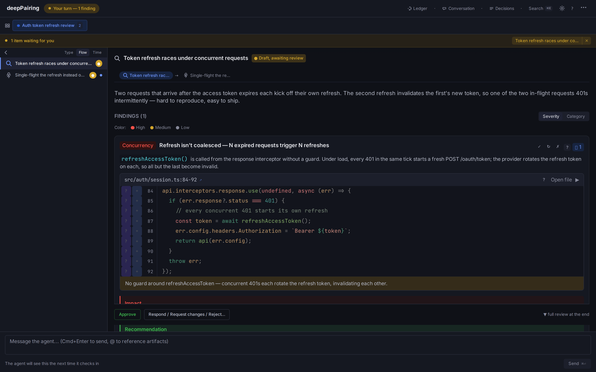

# deepPairing

**Hand Claude Code the implementation without handing it the decisions that
matter. It shows you the evidence, you make the call in a local review UI, and
what you turn down is checked against what the agent proposes next in that
repo.**

**Who it's for:** engineers who let Claude Code write most of the code but want
to own the architecture — the calls that are expensive to reverse.

**The problem:** an agent working alone quietly makes the load-bearing choices
(a global singleton for config, a new queue, a schema change). You meet them in
a 500-line diff, after the code is built on top of them. Or you reject an idea
on Tuesday, and on Thursday a fresh session proposes it again.

**What you get instead:** before it builds, Claude Code shows you what it found
(with file:line evidence), the options it weighed, and the plan. You comment,
pick, or reject in the companion UI. When you reject an approach with a reason,
this project's gate checks later proposals against it and refuses a match,
quoting your reason back. The run ends with a debrief of what changed and what
still needs your eyes.

*No account · no telemetry · everything stays on your disk.*



**Poor fit:** one-line fixes and throwaway scripts (the review is heavier than
the change). Fully unattended runs where nobody will look at the UI. Teams that
need a hard policy engine: the gate is a local word matcher, not a security
boundary. Editors other than Claude Code.

## What the gate does, and what it doesn't

- **`present_*` tools — refused.** Reject *"global mutable state for config"*,
  and *"keep config in global mutable states"* is refused before the artifact
  is recorded.
- **Matching is on words, not meaning.** It uses stemmed words plus a small,
  hand-audited synonym list. *"A module-level mutable settings object"* shares
  too few words with that concept, so it gets through. False positives happen
  too: *"remove global mutable state from config"* is refused, because it
  contains every word of the concept. Choose **Allow this proposal once** to
  let that exact proposal through and keep the stance; **Retire this stance**
  deletes it.
- **Direct `Edit`/`Write`/`MultiEdit` — you're asked, not refused.** A
  `PreToolUse` hook pauses a matching edit with a permission prompt, and you
  decide. It doesn't check `Bash` or notebook edits against your stances, and
  if it breaks, it lets the edit through. The prompt depends on how Claude Code
  is running: `bypassPermissions` skips it and `dontAsk` refuses instead.
- **The plugin's hooks ask about more than stances.** They also ask before
  writes to migrations, CI config, infrastructure and secret files (`.env`) that
  no approved, recent work covers, and before an agent edit to deepPairing's own
  state files. `DEEPPAIRING_GUARDRAIL_BACKSTOP=off` turns off the first kind, not
  the second. Claude Code's dialog can omit the reason; the companion shows why.
  See [what the hooks do](SECURITY.md#hooks-what-the-plugin-runs-on-your-machine).
- **Other projects — a nudge only.** It's off until you turn on cross-project
  publishing, and it never blocks.
- **Not a security boundary.** [SECURITY.md](SECURITY.md) has the threat model.

The full rules and limits are in
[Your taste compounds](docs/features.md#your-taste-compounds).

## What you get

- **Evidence and decisions.** Options arrive as cards with pros, cons, effort
  and risk. Plans tick off as the work lands. You comment inline, even on a
  region of a diagram.
- **A record.** A project-wide view of what was chosen and why, plus session
  replay.
- **Sharing.** Export a session as one self-contained page. It carries
  diffs by default and warns before it ships anything that looks like a secret.
  To leave code out, untick **Include code in the page** in the companion's
  export menu, or ask Claude for `includeCode: false` with `/deeppairing:share`.
- **PR review.** `/deeppairing:review-pr <N>` brings a colleague's PR onto the
  same surface. Your verdict stays local until you run `/deeppairing:post-pr`.

Planning, memory, blocking and inline diff feedback each exist elsewhere
already. What deepPairing adds is that your rejection comes back as a checked
stance; see [how it compares](docs/faq.md#how-is-this-different-from-plan-mode).
The [feature tour](docs/features.md) has the rest, with screenshots.

## Get started

Inside Claude Code:

```bash
/plugin marketplace add https://github.com/mitchjablonski/deepPairing
/plugin install deeppairing@deeppairing
```

You need Claude Code and Node on your `PATH`: 22 or 24 recommended (what CI
tests). 20.11+ still works but is deprecated, with removal planned no earlier
than v0.2.0 (not before January 2027; see
[INSTALL.md](INSTALL.md#nodejs-support-policy)). No pnpm, clone or build needed: the
plugin ships a prebuilt server. There is no npm package. Other
install paths are in [INSTALL.md](INSTALL.md).

## Your first review

1. **Terminal: start Claude Code in your project.** On its first start, the
   local daemon opens the companion in your browser, on a per-project port in
   `3847-3974` (recorded in `.deeppairing/daemon.json`). If no tab opens, run
   `/deeppairing:start` and Claude gives you the URL.
2. **Terminal: ask for real work,** for example *"Analyze the auth module and
   propose options."* Until Claude presents something, the companion shows
   *Waiting for Claude*.
3. **Companion: review.** Comment on a line, pick an option, ask "why", approve,
   or reject with a reason. A rejection becomes a gate in this project.
4. **Terminal: Claude picks up your feedback.** Claude doesn't block while you
   review; it reads your feedback with `check_feedback`, and late feedback stays
   queued in the session. If Claude hasn't responded, tell it to *"check
   feedback"*.

If something is stuck, see [docs/troubleshooting.md](docs/troubleshooting.md).

## Try the sample demo (no build)

The demo plays a **scripted sample**. No AI agent or model runs; a script plays
the agent's part on synthetic content, including a re-proposal in new words
that the gate refuses. It needs only Node, not Claude Code:

```bash
# From a download of this repo (git clone or a ZIP):
node claude-plugin/server/demo.mjs

# Or from an installed plugin:
find ~/.claude/plugins -name demo.mjs -path '*deeppairing*'
node "<that path>"
```

**Press Enter (or Ctrl+C) to end it.** It runs in a temporary sandbox that is
deleted when it ends, and it doesn't touch your projects, their daemons or your
cross-project ledger.
[Sandbox details](INSTALL.md#the-sample-demo-sandbox).

## More

[FAQ](docs/faq.md) · [Architecture](docs/architecture.md) ·
[Contributing](CONTRIBUTING.md)

## Status

Pre-1.0. Installable from this repo; not on npm or any public or community
marketplace yet.

## License

[MIT](LICENSE)
