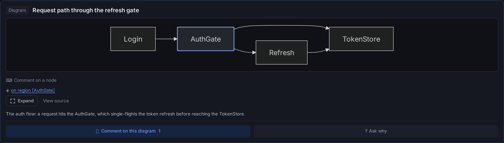
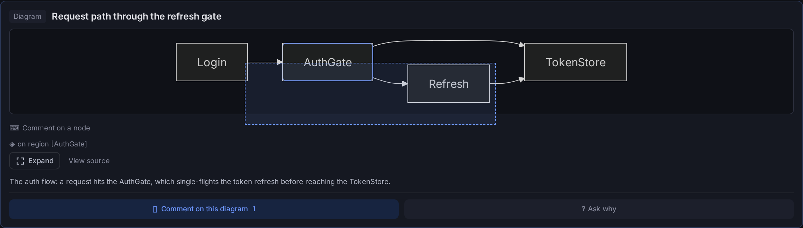
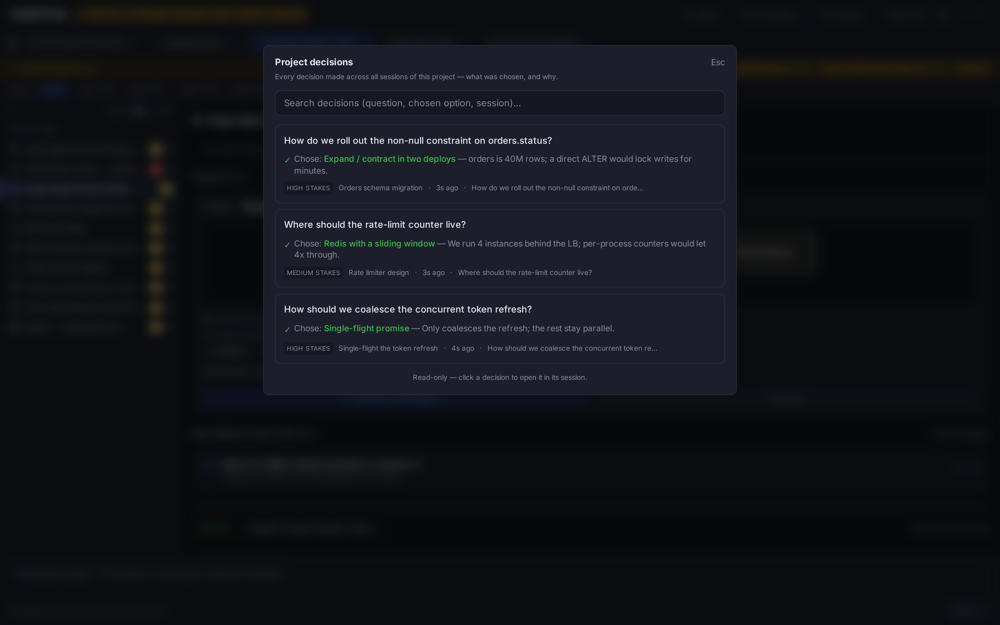
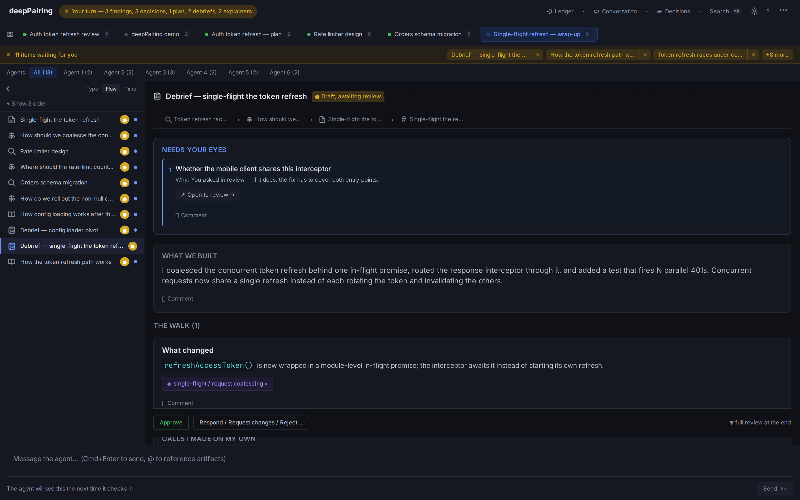
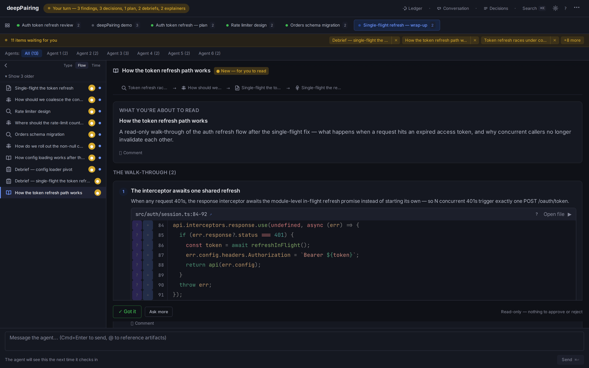
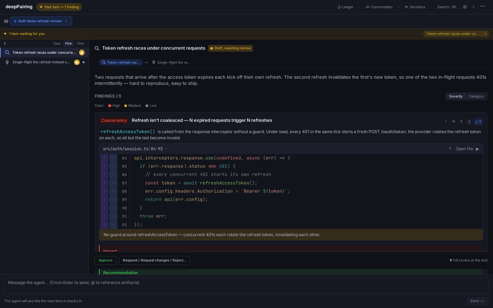
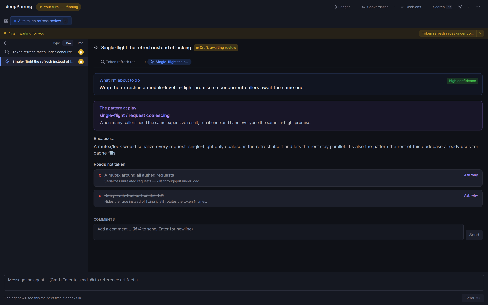
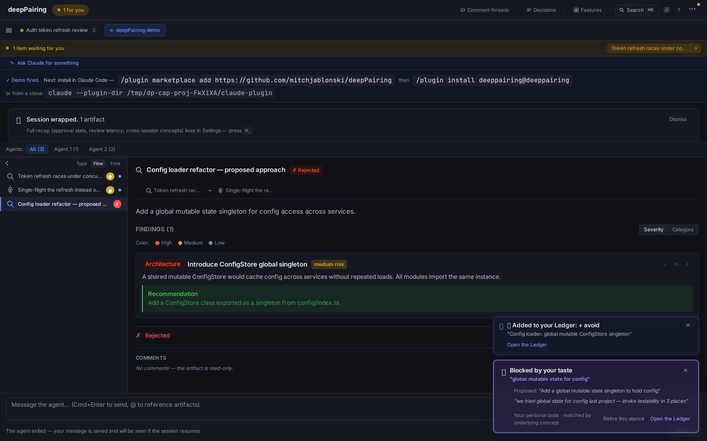
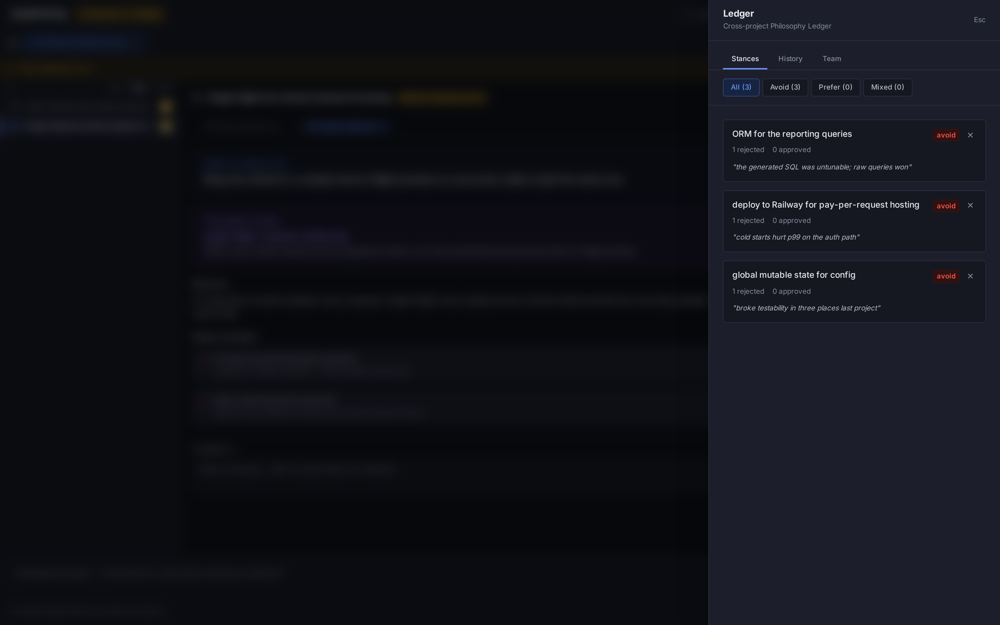

# What deepPairing does

The detail behind the [README](../README.md): the feature tour, how a session
runs, and the full rules and limits of the rejection gate.

## What you get

- **The rejection gate.** Reject an approach with a reason, and in this
  project a `present_*` call that matches it is refused, with your reason
  quoted back. A direct `Edit`/`Write` that matches is paused for your approval
  by a `PreToolUse` hook rather than refused. Once you enable cross-project
  publishing, your other projects get an advisory nudge about the same stance,
  never a block. Matching is on words and a short synonym list, not meaning
  ([limits](#your-taste-compounds)).
- **Decision cards.** Options arrive as cards you pick in the UI — pros, cons,
  effort, and risk laid out side by side. Hard-to-reverse calls are flagged
  "high stakes" so you see at a glance which choices are load-bearing.
- **A closing debrief.** Every feature or autonomous run ends with one debrief
  artifact: the narrative of what changed and why, the calls the agent made
  without you, what still needs your eyes, and an ask-anything thread — so you
  understand the change, not just approve it. For code archaeology ("how does
  auth work here?") the agent narrates a read-only explainer walk-through.
- **Live plan checklists.** Plans render as checklists that tick off as the
  work lands, so "what's left" never lies.
- **Comment on the diagram itself.** Drag a rectangle on a plan or spec's
  Mermaid diagram and your comment anchors to the nodes it covers — and
  survives the agent redrawing the diagram.


- **Every decision, one place.** A project-wide decisions view lists what was
  chosen and why across all your sessions, searchable, with a jump back into
  the session where you made the call.
- **A Detail dial.** Rich or Terse — how much text rides inside each artifact.
  Terse trims the prose; the artifacts and evidence stay.
- **Session replay.** Reopen any past session from the command palette →
  **Browse past sessions (replay)** and step back through its artifacts,
  comments, and decisions in order.
- **Multi-project switcher.** One companion UI aggregates every project you're
  pairing on, with a "waiting on you" badge when it's your move.
- **Share the session.** Export any session as a single self-contained web page
  — the narrative, decisions, debrief, and the diffs by default — from the
  companion UI's **Share as page (.html)** menu or `/deeppairing:share`. It
  travels to teammates who never install deepPairing, and it warns before it
  ships anything that looks like a secret. To strip every code body and diff when the code
  shouldn't leave the building, untick **Include code in the page** in the
  companion's export menu, or ask Claude for `includeCode: false` with
  `/deeppairing:share`. From a source build's CLI, it's
  `deeppairing export html --redact-code`.
  <!-- user-field: a `docs/assets/share-page.png` crop of the rendered page header would go here -->
- **Review a PR in tandem.** `/deeppairing:review-pr <N>` pulls a colleague's
  GitHub PR onto the review surface — the diff per hunk, walk-me-through, and
  findings anchored to real lines. Your verdict stays local until you send it:
  `/deeppairing:post-pr` posts it back as a PR review only when you say so.
  <!-- user-field: a short GIF of a PR landing on the review surface would go here -->
- **Keyboard-first review.** Navigate artifacts, comment, pick options, and ask
  "why" without leaving the keyboard.










## How it works

Talk to Claude Code the way you already do. When the work involves
investigating, deciding, planning, or changing code, deepPairing routes it
through structured MCP tools instead of a plain-text dump:

```
GATHER   → the agent investigates and presents findings with real evidence
PRESENT  → options, specs, and plans land in the companion UI for you to read
DECIDE   → you comment inline, pick options, ask "why", request revisions
BUILD    → only after you've shaped the direction; changes show as diffs
DEBRIEF  → the run ends with the story: what changed, why, what needs your eyes
```



The companion UI is where you review and steer; the terminal stays your primary
chat surface. The MCP server runs *inside* Claude Code (it IS the agent — no
separate orchestrator) and serves the UI on a deterministic per-project port in
`3847-3974`, derived from the project path (recorded in `.deeppairing/daemon.json`).

## What makes it feel collaborative

- **Structured artifacts you shape, not skim.** Findings, specs, options,
  plans, and code diffs render with evidence (file\:line, snippets, the
  reasoning) and inline commenting — so you engage with the *thinking*, not just
  a final patch.
- **Concept-naming as a teaching lever.** Every `log_reasoning` surfaces the
  pattern at play, so you pick up the vocabulary and the agent's reasoning is
  legible — learning flows both directions.
- **It writes *to* you.** Second person, like a pair ("which of these fits how
  we handle auth?"), not a third-person audit log narrating what "the user"
  asked.
- **Pair-tempo signals.** An "I see you" toast on every comment, a
  questions-waiting badge, a turn indicator that's honest about whose move it
  is. The collaboration is *felt*, not just logged.



## Your taste compounds



*This capture is out of date. It shows **Retire this stance** on the card and
no **Allow this proposal once** button. Today Allow once is the card's main
button, and Retire lives in the ⋯ gate log, behind a confirm.*

So you never have to make the same call twice:

- **You're not silently re-proposed past.** Four surfaces, four different
  guarantees:
  - **`present_*` tools, this project: refused.** A matching proposal gets a
    `REJECTED_APPROACH_BLOCKED` error, the artifact is not recorded, and your
    reason is quoted back. `revise_artifact` runs the same check. The one
    exception is a proposal you allowed once (from the companion UI, or the
    interactive CLI): that exact proposal goes through, once, and the
    artifact carries an "Allowed once" badge. For
    `present_debrief` and an external-PR `present_changeset`, a match is
    reported as advice instead, because those describe work that already
    exists.
  - **Direct `Edit`/`Write`/`MultiEdit`, this project: asked.** The
    `PreToolUse` hook runs the same matcher on the new text and file path,
    and a match becomes a Claude Code permission prompt (`ask`). It never
    returns `deny`, so you can allow the edit. It doesn't check `Bash` or
    `NotebookEdit` against your stances; one narrow `Bash` check asks before
    the shell grants a stance allowance, and that is the only Bash command it
    looks at. An allowance never removes this prompt: a direct edit carrying
    an allowed proposal still asks. It only reads this project's stances, and
    it fails open:
    if it errors, or the stance file can't be parsed, the edit proceeds.
    An agent edit to deepPairing's own state
    (`.deeppairing/preferences.json`, `team.json`, anything in
    `.deeppairing/hooks/`, or the `.claude/settings*.json` files that register
    these hooks) always asks, notebook edits included, because
    rewriting the file would quietly drop a stance; a shell write to them
    (`echo >`, `sed -i`, `cp`) isn't checked. (Like every hook prompt, it
    depends on how Claude Code is running: `bypassPermissions` skips it and
    `dontAsk` refuses the command instead; see
    [SECURITY.md](../SECURITY.md#hooks-what-the-plugin-runs-on-your-machine).)
  - **Other projects: a nudge, never a block.** Turn on **cross-project
    publishing** (off by default; see below) and a matching proposal elsewhere
    gets an advisory note ("you avoided this in `<project>` — still want it
    here?"). Reject it there as well to make it block there. If the
    cross-project ledger can't be read, the note is skipped.
  - **Record a stance from the terminal.** `/deeppairing:reject global
    mutable state for config -- keep configuration explicit` (or
    `deeppairing stance add …` from a source install) records the same kind
    of project stance a rejected artifact does. The reason after ` -- ` is
    required. It shows you the concept and reason it saved, its scope (this
    project only) and what it will and won't catch. It only adds: an
    existing stance is never rewritten, and you correct or remove one with
    **Retire this stance** in the gate log or by editing
    `.deeppairing/preferences.json` yourself. A stance that would match
    deepPairing's own recovery commands is refused, and this path adds at
    most 200 stances per project. The agent is told to call it only with your
    words, when you ask; the server can't verify who typed them, so each
    stance records how it was added, and `/deeppairing:stance` lists them.
    For the same reason, a stance added through `/deeppairing:reject` is never
    published to the cross-project ledger; one added with `deeppairing stance
    add` in your own terminal publishes like any other when publishing is on.
  - **What counts as a match.** Every word of the concept (after light
    stemming, so *state*/*states* match) must appear in the proposal, or the
    rejected phrase itself must. A small, hand-audited **synonym list** widens
    that: *delete*↔*remove*, *directory*↔*folder*, *cache*↔*memoize*,
    *env*↔*environment*, *authentication*↔*login*↔*signin*, and
    *authorization*↔*authz*. Authentication and authorization are kept
    apart on purpose. That's the whole list. It is not semantic understanding.
    Reject *"global mutable state for config"*, and *"keep config in global
    mutable states"* is caught, while *"a module-level mutable settings
    object"* is not. A partial overlap, such as *"global state for config"*,
    goes through, with a near-miss note in the trace. So name the concept in
    the words the agent will reuse. Word matching needs a named concept: if
    you reject a finding, plan, or spec without typing one, the stance is
    just its title, and only that phrase (word-bounded) is matched. None of
    the rewordings above would be caught.
  - **False positives: allow once, or retire.** A proposal to *remove* global
    mutable state from config is refused too, because it contains every word
    of the concept. You have two ways out:
    - **Allow this proposal once** (the block card's main button, or
      `deeppairing stance allow <blockId>` in your own terminal). You see
      exactly what would be created, give a reason, and that exact proposal
      gets through the next time the agent retries the identical call. It is
      single-use, and it ends with the Claude session or after 72 hours,
      whichever comes first. The stance stays on for everything else. The
      allowance lives only in the daemon's memory, so a restart ends it; it
      is never mirrored to the cross-project ledger, and it records no
      approval. If what the proposal depends on changes first (say, a newer
      change to the same file), the allowance doesn't apply and you get a new
      block to look at instead.
    - **Retire this stance** (in the ⋯ gate log, behind a confirm) deletes
      the stance from this project. It stops blocking everywhere, not just
      here.

    Allowances are granted by you, not by the agent: the agent has no tool
    for it, and when its shell runs `stance allow` (or names the grant route,
    say with `curl`) you get a prompt. Whether you actually see that prompt depends on how Claude Code is running: `bypassPermissions` skips prompts, so the command can run without one; `dontAsk` denies it instead of asking; and a `-p` run with no one to answer denies it (details and sources in [SECURITY.md](../SECURITY.md#hooks-what-the-plugin-runs-on-your-machine)). That is human-only by
    design, not by enforcement: a process running as your user can still
    script a terminal, build the command or the URL at runtime so the shell
    check doesn't see it, or call the daemon's route directly with the token
    it can read. The shell check also asks on harmless text that contains the
    words, such as `grep -rn "stance allow"` or a commit message. Receipts (the block log, the badge,
    the debrief and export lists) cover these supported paths; they are not
    tamper-evident and don't identify who granted anything. (Blocks from a
    committed **team rule** can't be allowed once; they point you to
    `.deeppairing/team.json` instead.) Tests:
    [preflight-validator](../packages/mcp-server/src/mcp/__tests__/preflight-validator.test.ts),
    [paraphrase-alias](../packages/mcp-server/src/mcp/__tests__/paraphrase-alias.test.ts),
    [preflight-hook-core](../packages/mcp-server/src/cli/__tests__/preflight-hook-core.test.ts),
    [tool-helpers-global-advisory](../packages/mcp-server/src/mcp/__tests__/tool-helpers-global-advisory.test.ts).
- **A backstop on the paths you can't undo.** The same PreToolUse hook also
  watches your guardrail paths — migrations, CI config, infrastructure, `.env`
  and other secret files. If the agent starts writing to one of them and no
  approved, recent, non-demo findings, options, spec, or plan covers the edit,
  you get a prompt naming the path and the class before the edit lands. Covering
  means the artifact declares that exact file path, or, with no declared scope,
  an approved spec or plan in the same session. A scopeless findings or options
  card never authorizes the edit, so presenting one doesn't stop the prompt. By
  default it asks rather than hard-blocking, it fails open, and
  `DEEPPAIRING_GUARDRAIL_BACKSTOP=off` turns it off.
  If your Claude Code permission UI omits the reason, opt into
  `DEEPPAIRING_PREFLIGHT_MODE=strict-stop` to deny matching edits and stop for
  review. See [compatibility modes and recovery](preflight-modes.md).
  A stopped worker does not stop its parent. Its automatic background completion
  notification may omit the warning. Delegated strict-stop work requires the
  [bounded, supervised handoff check](preflight-modes.md#supervised-worker-handoff),
  not an assumption that a completion notification means approval.
- **The ledger underneath.** Reject something with a reason and the stance is
  remembered. It's remembered **in this project** always; it reaches your
  *other* projects — `~/.deeppairing/philosophy/v1.json` — only once you enable
  cross-project publishing. Reads are global (every repo sees whatever ledger
  you've accumulated); writes are **opt-in per project**, default off, so a
  dependency in one project can't poison the others. Turn it on from
  **Autonomy → Cross-project memory** in the companion UI (you're also offered
  it once, right after your first "Reject & remember"), at `init`, or with
  `deeppairing philosophy publish on`. Portable via
  `deeppairing philosophy export | import --merge`; drop a stance you no
  longer hold (whole entry, ledger backed up first) with
  `deeppairing philosophy remove <concept>` or the ✕ in the Ledger drawer.
- **Three-layer memory, never merged.** Filesystem-sensed guardrails
  (migrations, CI), committable team conventions, and personal philosophy are
  surfaced to the agent separately.


